<picture>
  <source media="(prefers-color-scheme: dark)" srcset="assets/header-dark.svg">
  
</picture>

   <a href="https://www.linkedin.com/in/shauryasriv/"><picture><source media="(prefers-color-scheme: dark)" srcset="assets/badge-linkedin-dark.svg"></picture></a><a href="mailto:shauryasri14@gmail.com"><picture><source media="(prefers-color-scheme: dark)" srcset="https://img.shields.io/badge/email-21262d?style=flat-square&logo=gmail&logoColor=d4f53c"></picture></a>
  <a href="https://github.com/shauryasri14?tab=repositories"><picture><source media="(prefers-color-scheme: dark)" srcset="https://img.shields.io/badge/all_repositories-21262d?style=flat-square&logo=github&logoColor=d4f53c"></picture></a>

 

## 01 &nbsp;·&nbsp; who i am

Mathematics & Computing student from India. I like understanding why things work, whether it's a tricky algorithm or a bug that won't go away.

I work where math meets code: algorithms, data structures, and AI. I'm looking for real projects to build and people to build them with.

Outside code, I read about astronomy. It's a reminder that most big questions are still open, and that's fine by me.

| | |
|:--|:--|
| **focus** | local AI tooling · retrieval · data pipelines |
| **exploring** | quantitative finance · astrodynamics · ML fundamentals |
| **based in** | India |
| **reach me** | [LinkedIn](https://www.linkedin.com/in/shaurya-srivastava-140505cxvadsv/) · [shauryasri14@gmail.com](mailto:shauryasri14@gmail.com) |

 

## 02 &nbsp;·&nbsp; the work, charted

<picture>
  <source media="(prefers-color-scheme: dark)" srcset="assets/chart-dark.svg">
  
</picture>

| constellation | project | in one line |
|:--|:--|:--|
| **code decides, model explains** | [Chess-Move-Analyzer](https://github.com/shauryasri14/Chess-Move-Analyzer) | Offline chess game review: Stockfish grades, a local LLM explains |
| | [Lecture2notes](https://github.com/shauryasri14/Lecture2notes) | Lecture recording → notes, revision questions, verified deadlines |
| | [gst-sorter](https://github.com/shauryasri14/gst-sorter) | OCR + validation for Indian GST invoices, exported to Excel/CSV |
| | [git-graveyard](https://github.com/shauryasri14/git-graveyard) | Abandoned branches and dead TODOs, with LLM-written epitaphs |
| | [StrideWise](https://github.com/shauryasri14/StrideWise) | Walking/running routes scored on shade, traffic, air quality |
| **search & retrieval** | [RAGLite](https://github.com/shauryasri14/RAGLite) | Minimal RAG pipeline with Hit@5, MRR and refusal-accuracy evals |
| | [LANShare](https://github.com/shauryasri14/LANShare) | LAN file sharing with in-browser semantic search |
| **browser** | [TokenTrail](https://github.com/shauryasri14/TokenTrail) | Tracks token usage in AI chats and saves them before you run out |
| **data** | [AQI_Prediction](https://github.com/shauryasri14/AQI_Prediction) | Random Forest forecasting Delhi's AQI from hourly pollutant data |
| **from scratch** | [webserver-using-python](https://github.com/shauryasri14/webserver-using-python) | Multithreaded HTTP server on raw sockets |
| | [personal-finance_tracker](https://github.com/shauryasri14/personal-finance_tracker) | Personal finance tracker in C |

 

## 03 &nbsp;·&nbsp; how i build

> **01 — Code decides, the model explains.** 
> Anything that has to be correct comes from deterministic code. The LLM handles the wording.

> **02 — Offline by default.** 
> If something can run on the user's machine, it should.

> **03 — Small and finished beats big and planned.** 
> Ship a version that works, then improve it.

 

## 04 &nbsp;·&nbsp; toolbox

| | |
|:--|:--|
| **languages** | Python · C · C++ · JavaScript |
| **data & ml** | pandas · NumPy · scikit-learn · FAISS · sentence-transformers |
| **local ai** | Ollama · faster-whisper · transformers.js |
| **everything else** | Git · Linux · FastAPI · browser extensions |

 

<picture>
  <source media="(prefers-color-scheme: dark)" srcset="assets/footer-dark.svg">
  
</picture>
